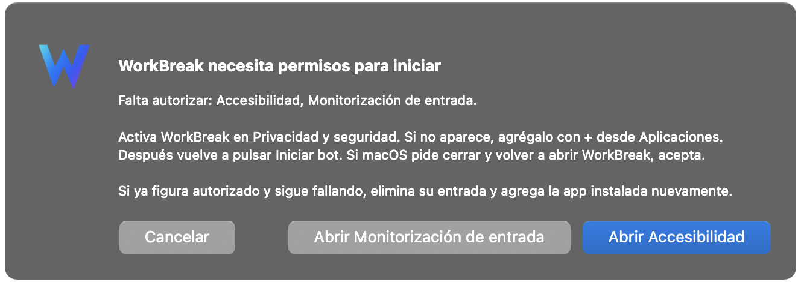
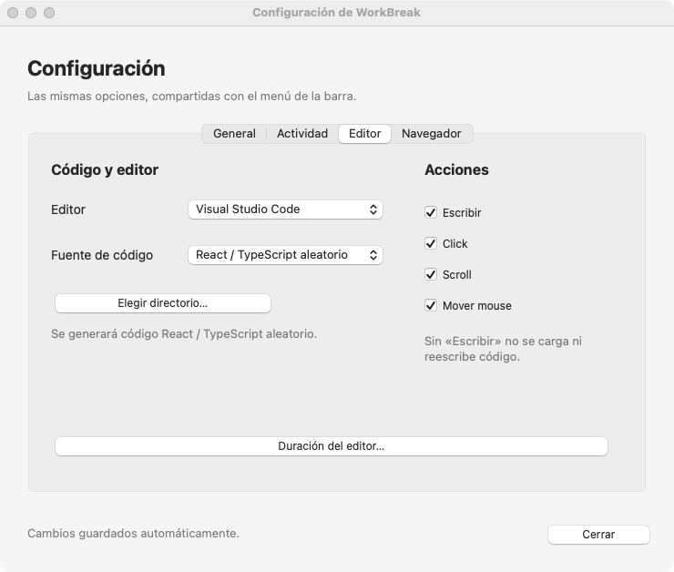
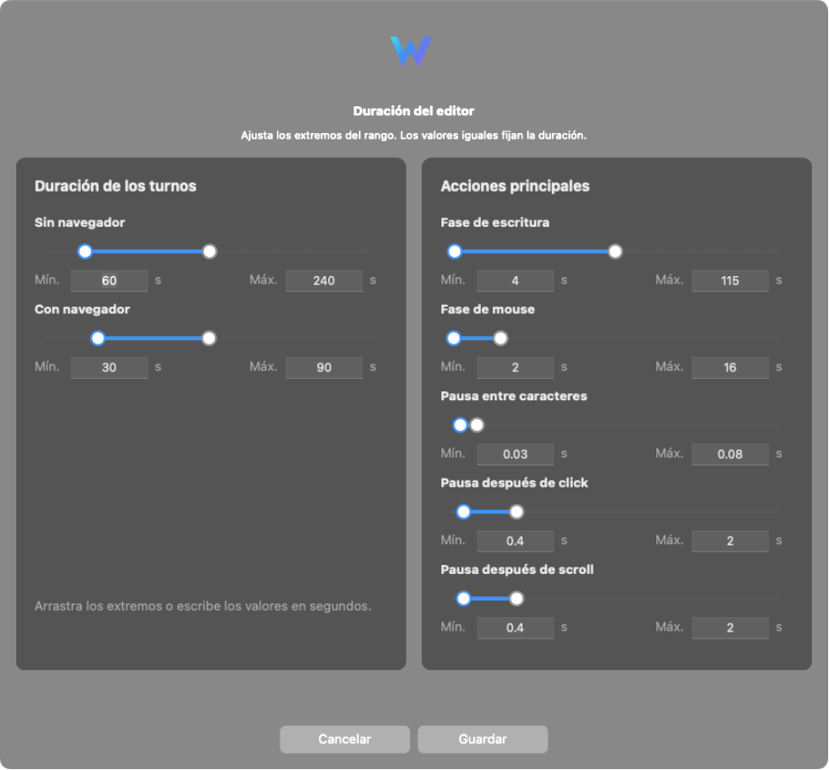
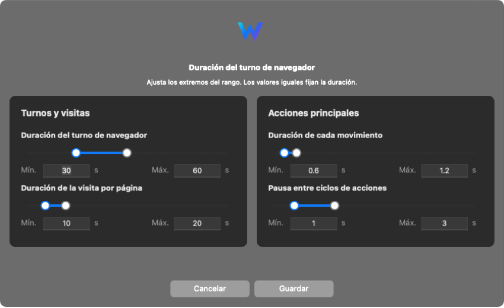
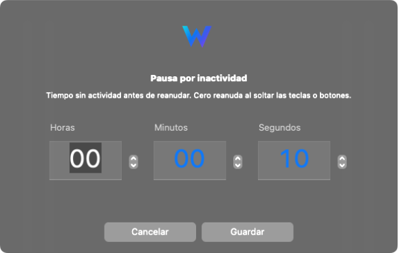
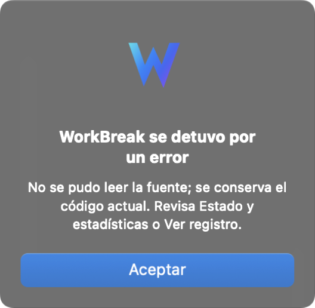

<p align="center">
  
</p>

<h1 align="center">WorkBreak</h1>

<p align="center">Automatización de escritura y navegación desde la barra de menús de tu Mac.</p>

<p align="center">
  <a href="https://github.com/vjose1903/workBreak/releases/latest"></a>
  
  
  <a href="https://github.com/vjose1903/workBreak/actions/workflows/release-macos.yml"></a>
</p>

<p align="center">
  <a href="#descargar-e-instalar">Descargar</a> ·
  <a href="#permisos">Permisos</a> ·
  <a href="#configurar-el-bot">Configuración</a> ·
  <a href="#tiempos-y-pausas">Tiempos</a> ·
  <a href="#actualizar">Actualizar</a> ·
  <a href="docs/DEVELOPMENT.md">Desarrollo</a>
</p>

WorkBreak puede trabajar en un editor, navegar por webs o alternar ambos. Elige las acciones que quieres ejecutar, sus tiempos y la duración total. Al utilizar tu teclado o mouse, el bot pausa su actividad y reanuda después del tiempo de inactividad configurado.

## Descargar e instalar

**Requiere macOS 15 o posterior.** El instalador incluye Python y las dependencias.

| Tu Mac | Descarga de la última versión estable |
| --- | --- |
| Apple Silicon · chip Apple M… | [Descargar DMG arm64](https://github.com/vjose1903/workBreak/releases/latest/download/WorkBreak-macos-arm64.dmg) |
| Intel | [Descargar DMG x86_64](https://github.com/vjose1903/workBreak/releases/latest/download/WorkBreak-macos-x86_64.dmg) |

Puedes identificar tu procesador en ** → Acerca de este Mac**. Los enlaces se actualizan con cada Release; también puedes consultar [todas las versiones](https://github.com/vjose1903/workBreak/releases).

1. Abre el DMG y ejecuta el instalador `.pkg` que contiene.
2. Abre **WB** desde Aplicaciones y busca su **W** en la barra de menús.
3. Configura el editor, navegador, acciones y tiempos.
4. Pulsa **Iniciar bot**. Para terminar, selecciona **Detener bot**.

La aplicación y su ejecutable se llaman **WB** (`WB.app/Contents/MacOS/WB`); conserva la configuración y los registros de WorkBreak. Al actualizar desde una versión llamada WorkBreak, puede ser necesario abrir **WB** manualmente al terminar la instalación.

El bot nunca comienza automáticamente al abrir la aplicación. **Windows está en desarrollo:** todavía no tiene instalador ni interfaz equivalente publicados.

## Permisos

| Permiso | Uso |
| --- | --- |
| **Accesibilidad** | Enviar teclado y mouse y verificar las ventanas. |
| **Monitorización de entrada** | Detectar tu actividad para pausar. |
| **Automatización** | Consultar el navegador cuando admite lectura de su URL. |
| **Notificaciones** | Mostrar avisos de error con sonido. |

Al iniciar, WorkBreak comprueba Accesibilidad y Monitorización de entrada. Si falta alguna, muestra botones para abrir su panel en **Ajustes del Sistema → Privacidad y seguridad**. Después de concederla, vuelve a iniciar el bot; reinicia WorkBreak si macOS lo solicita.

<p align="center">
  
</p>

La app compilada solicita permiso de notificaciones al pulsar **Iniciar bot**. macOS recuerda tu respuesta: si lo rechazaste, puedes cambiarla en **Ajustes del Sistema → Notificaciones → WB**. Los permisos de Terminal o Python no sustituyen los de la app instalada.

## Configurar el bot

El menú y la ventana **Configuración…** comparten las mismas preferencias. Los cambios se guardan automáticamente y se aplican en la siguiente corrida. Durante una sesión se bloquea la configuración, pero puedes detener el bot, consultar estadísticas o abrir el registro.

<p align="center">
  
</p>

| Apartado | Opciones |
| --- | --- |
| **General** | Abrir WB al iniciar sesión. Disponible en la copia instalada en Aplicaciones; abre la W, sin iniciar el bot. |
| **Actividad** | Editor y navegador, solo editor o solo navegador; duración total, pausa por inactividad y configuraciones recientes. |
| **Editor** | Editor instalado, fuente de código, acciones y duración. En el menú, **Fuente de código** está dentro de Editor. |
| **Navegador** | Navegador, webs, acciones y duración. En el menú, **Webs…** está dentro de Navegador. |

<p align="center">
  
</p>

**Editores compatibles:** Visual Studio Code, Cursor, Windsurf y VS Code Insiders. Se muestran los instalados y se elige VS Code por defecto si está disponible. **Navegadores:** Chrome, Edge, Opera y Firefox. En la primera apertura se selecciona y guarda el navegador predeterminado de macOS si es compatible. Tu elección manual se conserva entre aperturas, incluso «Ninguno». Si el predeterminado no es compatible, debes elegir uno de los admitidos.

- **Acciones del editor:** escribir, click, scroll y mover mouse.
- **Acciones del navegador:** click, scroll y mover mouse.
- Sin **Escribir**, no se pega ni reescribe código. Sin **Mover mouse**, los clics y el scroll requieren que el cursor ya esté dentro del área segura.
- Para iniciar debe quedar al menos una acción habilitada. Solo navegador requiere un navegador y al menos una web.

<details>
<summary>Ver las demás pestañas y el modo claro</summary>

<p></p>
<p></p>
<p></p>
<p></p>

</details>

Las ventanas siguen el modo claro u oscuro del sistema. Las capturas corresponden a la interfaz real del checkout, con datos de ejemplo; para obtenerlas no se ejecutó la automatización ni se cambiaron tus preferencias.

### Código y webs

WorkBreak reutiliza una ventana del editor y abre una pestaña temporal. Si no hay ventanas, crea un espacio temporal con ajustes de edición controlados. **No edita los archivos originales ni los ajustes globales del editor.**

| Fuente de código | Comportamiento |
| --- | --- |
| **Aleatorio** | Genera código React/TypeScript. |
| **Directorio real** | Lee archivos `.tsx`, `.jsx`, `.ts` y `.js` de 20 a 400 líneas y hasta 2 MiB; omite carpetas como `node_modules`, `dist` y `build`. Rota el archivo por tiempo o número de fases. |

En **Navegador → Webs…**, escribe un nombre y una dirección, pulsa **Agregar** y después **Guardar**. Para quitar una entrada, selecciona su fila y pulsa **Quitar seleccionada**. **Cancelar** descarta los cambios del diálogo.

<details>
<summary>Ver el administrador de webs</summary>


</details>

## Tiempos y pausas

**Tiempo…** define la duración total en horas, minutos y segundos. **Tiempo indefinido** mantiene el bot activo hasta que lo detengas. El límite total también cuenta durante las pausas por actividad; la limpieza puede terminar después.

En **Editor → Duración…** y **Navegador → Duración del turno…**, cada slider tiene dos extremos: mínimo y máximo. Puedes escribir segundos exactos; usa valores iguales para una duración fija.

<p align="center">
  
</p>

<p align="center">
  
</p>

| Control | Valor predeterminado |
| --- | --- |
| Pausa por inactividad | 10 s |
| Editor sin navegador / al alternar | 60–240 s / 30–90 s |
| Fase de escritura / mouse | 4–115 s / 2–16 s |
| Pausa entre caracteres | 0.03–0.08 s |
| Pausa tras click / scroll del editor | 0.4–2 s cada una |
| Turno del navegador / visita por página | 30–60 s / 10–20 s |
| Movimiento del navegador / pausa entre ciclos | 0.6–1.2 s / 1–3 s |

Las fases y movimientos requieren tiempos positivos; las pausas admiten cero. Los ajustes secundarios de versiones anteriores se conservan aunque no aparezcan en estos controles.

### Cómo pausa y reanuda

- **Teclado:** cualquier tecla, incluidos Command, Shift, Option y Control, pausa desde el inicio.
- **Mouse:** tiene cinco segundos de margen al arrancar; después, movimiento, click o scroll activan la pausa.
- **Reanudación:** cada actividad reinicia la cuenta. Una tecla o botón mantenido impide reanudar hasta soltarlo. Con pausa en cero, reanuda al soltar.
- **Trabajo pendiente:** continúa las líneas interrumpidas. Si una copia quedó sin confirmar, conserva el portapapeles actual completo como nueva referencia.
- **Detención:** **Detener bot** funciona durante la pausa. **Salir de WorkBreak** espera la limpieza. Llevar el mouse a una esquina de la pantalla principal activa la parada de emergencia.

<details>
<summary>Ver los controles de inactividad y duración total</summary>

<p></p>
<p></p>
<p></p>

</details>

El bot verifica el archivo y el contenido antes de reescribir, consulta **Ir a línea** una vez por corrida y escribe carácter por carácter. Usa el portapapeles para la carga inicial y las comprobaciones; conserva sus formatos nativos y respeta cambios externos. Puede detenerse si no logra confirmar el destino.

El mouse se limita al área visible de la ventana, también con monitores Retina o coordenadas negativas. Las pestañas del navegador pueden quedar abiertas al terminar. Desactiva **Click** si no quieres que se activen enlaces o botones de las webs.

Los eventos son sintéticos: WorkBreak no garantiza que un monitor de actividad los clasifique como interacción humana.

## Errores y notificaciones

Un error, una parada de emergencia o una salida inesperada del proceso generan un aviso con el motivo y una indicación para consultar el registro. Las pausas, las paradas manuales y las finalizaciones normales no generan notificaciones.

La app instalada usa notificaciones de macOS. Si se deniegan o falla el envío, muestra un **aviso interno**, que también se utiliza al ejecutar desde Python. Los banners y sonidos dependen de los ajustes de notificaciones y Concentración.

<p align="center">
  
</p>

## Actualizar

1. Con el bot detenido, selecciona **Buscar actualizaciones…**.
2. Pulsa **Descargar actualización** y espera la descarga y verificación.
3. Elige **Instalar y reiniciar** y autoriza la instalación si macOS lo solicita.

<p align="center">
  
  
</p>

<details>
<summary>Ver el progreso de descarga</summary>


</details>

Los diálogos muestran una versión posterior **de ejemplo**, no una Release anunciada. La instalación automática requiere abrir WorkBreak desde **Aplicaciones**. Verifica HTTPS, tamaño, SHA-256, identificador, versión y destino del paquete; si cancelas o falla, intenta reabrir la app existente. La configuración se conserva.

## Registro y solución de problemas

Abre **Ver registro…** desde la W, o sigue los logs en Terminal mientras usas la app normalmente:

```bash
tail -n 100 -f "$HOME/Library/Logs/WorkBreak/workbreak.log"
```

| Situación | Qué revisar |
| --- | --- |
| macOS bloquea la apertura | Revisa **Privacidad y seguridad**. La distribución está firmada con Developer ID; el workflow no la notariza. |
| Un permiso figura activo pero sigue fallando | Comprueba que corresponde a la copia instalada. Si procede de otra compilación, elimina esa entrada y agrega WorkBreak nuevamente. |
| No llega la notificación | Revisa **Notificaciones → WB** y Concentración. El aviso interno sirve como alternativa. |
| No encuentra código | Comprueba extensiones, tamaño y rango de líneas del directorio. |
| Se detiene al escribir | Consulta el registro: un cambio del archivo, contenido o foco puede activar la protección. |
| No aparece una actualización o falla la descarga | Comprueba [Releases](https://github.com/vjose1903/workBreak/releases) y el estado de [Actions](https://github.com/vjose1903/workBreak/actions). |
| El instalador pide cerrar WorkBreak | Sal desde el menú de la W antes de instalar. |

Las preferencias y el historial de la app instalada se guardan en `~/Library/Application Support/WorkBreak/`. Los logs están en `~/Library/Logs/WorkBreak/`: `workbreak.log` para el bot y `update.log` para el instalador. Estos datos sobreviven a las actualizaciones.

Para ejecutar desde Python, compilar, firmar o publicar una versión, consulta la **[guía de desarrollo](docs/DEVELOPMENT.md)**.
