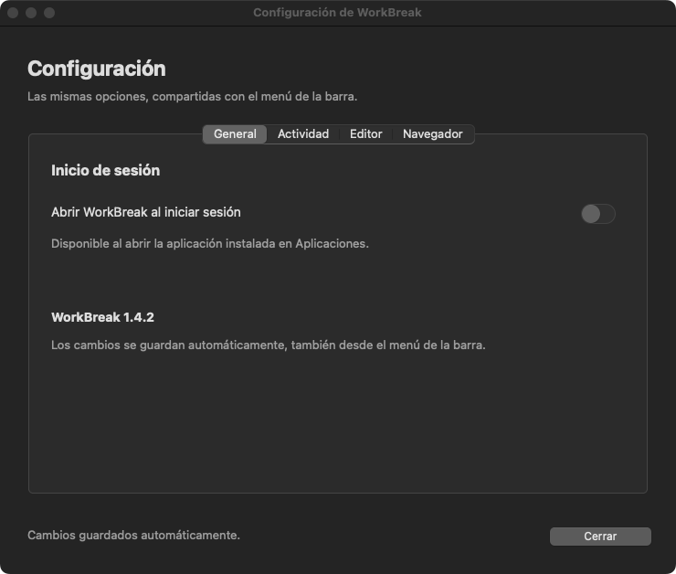
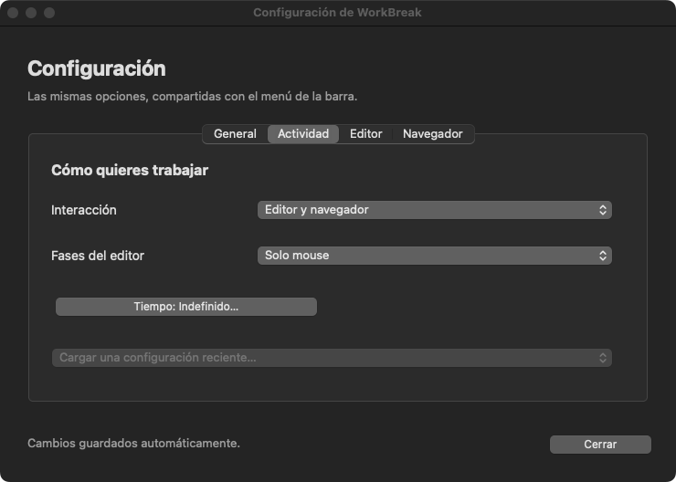
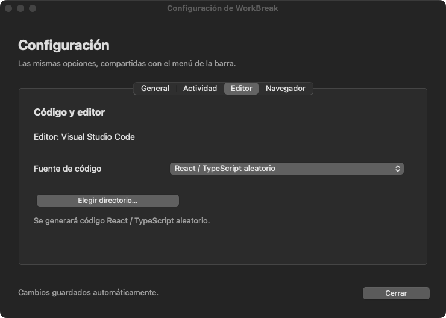
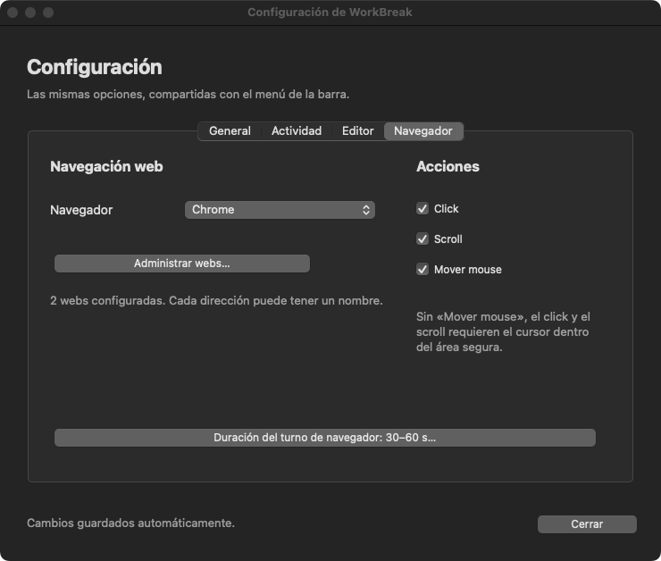
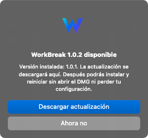
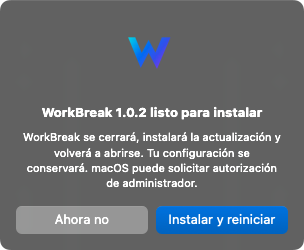
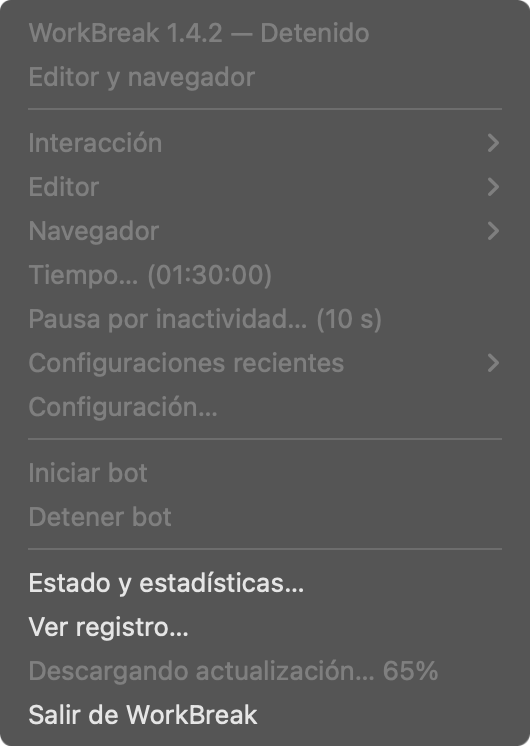

<p align="center">
  
</p>

<h1 align="center">WorkBreak</h1>

<p align="center">
  Automatización de escritura y navegación, desde la barra de menús de tu Mac.
</p>

<p align="center">
  <a href="https://github.com/vjose1903/workBreak/releases/latest"></a>
  
  
  <a href="https://github.com/vjose1903/workBreak/actions/workflows/release-macos.yml"></a>
</p>

<p align="center">
  <a href="#-descargas">Descargar</a> ·
  <a href="#-primeros-pasos">Primeros pasos</a> ·
  <a href="#-interfaz-y-configuración">Interfaz</a> ·
  <a href="#-actualizaciones">Actualizar</a> ·
  <a href="#-desarrollo-y-publicación">Desarrollo</a>
</p>

WorkBreak simula escritura en **Visual Studio Code** y movimientos y scroll en un navegador. Puedes utilizar solo el editor, solo la web o alternar ambos, elegir las acciones y definir una duración. Se controla desde su **W en la barra de menús**, sin mantener una terminal abierta cuando utilizas la aplicación instalada.

## 📥 Descargas

### 🍎 macOS · Intel y Apple Silicon

**Requisito: macOS 15 o posterior.** El instalador incluye Python y las dependencias; no necesitas instalarlos por separado.

| Tu Mac | Arquitectura | Última versión estable |
| --- | --- | --- |
| Apple Silicon · familia M1, M2, M3, M4 o M5 | `arm64` | [⬇ Descargar DMG para Apple Silicon](https://github.com/vjose1903/workBreak/releases/latest/download/WorkBreak-macos-arm64.dmg) |
| Procesador Intel | `x86_64` | [⬇ Descargar DMG para Intel](https://github.com/vjose1903/workBreak/releases/latest/download/WorkBreak-macos-x86_64.dmg) |

> **Disponibilidad:** los enlaces dinámicos requieren una Release estable publicada con los archivos de nombre fijo `WorkBreak-macos-arm64.dmg` y `WorkBreak-macos-x86_64.dmg`. El workflow los adjunta a las nuevas publicaciones. Hasta publicar una versión con este cambio, los enlaces pueden devolver 404. La ejecución nativa en Apple Silicon requiere además validación funcional en ARM.

Los botones de la tabla descargan directamente el **DMG**, sin pasar por una descarga del código fuente. Cada DMG contiene su instalador `.pkg`. El workflow adjunta a la Release únicamente los DMG de Intel y Apple Silicon; los PKG separados y las sumas SHA-256 se conservan como artefactos de compilación en Actions.

Los botones utilizan `/releases/latest/download/` y apuntan automáticamente a la **última Release estable**, sin editar el README con cada versión. También puedes consultar **[la última Release](https://github.com/vjose1903/workBreak/releases/latest)** o **[todas las versiones y sus cambios](https://github.com/vjose1903/workBreak/releases)**.

**¿Cuál necesitas?** En el menú  → **Acerca de este Mac**, si aparece «Chip Apple M…», elige Apple Silicon. Si aparece «Procesador Intel», elige Intel.

### 🪟 Windows · En construcción

🚧 **La aplicación y el instalador para Windows están en construcción.** Todavía no hay un ejecutable Windows publicado ni una interfaz equivalente a la de macOS. El repositorio conserva el modo de terminal y las dependencias de Windows para desarrollo; esto no equivale a una distribución terminada.

## 🚀 Primeros pasos

1. **Descarga** el DMG correspondiente a tu procesador.
2. **Abre el DMG** y ejecuta el archivo `.pkg` que contiene.
3. **Abre WorkBreak** desde Aplicaciones. Busca su W en la barra superior.
4. **Configura** la interacción, navegador, webs, fuente de código y tiempo.
5. Pulsa **Iniciar bot**. Para finalizar, abre la W y selecciona **Detener bot**.

El bot comienza únicamente cuando pulsas **Iniciar bot**. En los modos que usan el editor necesitas tener **un editor compatible instalado**; para la interacción web, el navegador elegido debe estar instalado.

### 🔐 Permisos y primera apertura

Concede los permisos que solicite macOS en **Ajustes del Sistema → Privacidad y seguridad**:

| Permiso | Para qué se utiliza |
| --- | --- |
| **Accesibilidad** | Enviar las interacciones de teclado y mouse y verificar las ventanas. |
| **Monitorización de entrada** | Detectar tu actividad y pausar la automatización. |
| **Automatización** | Activar y consultar el editor y el navegador. |

La distribución utiliza **firma local ad hoc, sin Developer ID ni notarización de Apple**. macOS puede bloquear la primera apertura de una descarga: revisa la autorización en **Privacidad y seguridad**. No es necesario desactivar Gatekeeper. Después de actualizar, macOS puede pedir renovar permisos.

Los permisos pertenecen a la aplicación desde la que ejecutas el bot: los de Terminal o Python no sustituyen los de **WorkBreak.app**.

## 🖥️ Interfaz y configuración

Las siguientes son **capturas reales de la interfaz del proyecto**, con direcciones de ejemplo. No se inició la automatización para obtenerlas.

### El menú de WorkBreak

<p align="center">
  
</p>

| Opción | Qué puedes configurar |
| --- | --- |
| **Interacción** | Editor y navegador, solo editor o solo navegador. |
| **Navegador y Webs…** | Navegador y direcciones identificadas por nombre. |
| **Fuente de código** | Código aleatorio o archivos de un directorio real. |
| **Tiempo…** | Duración de la ejecución. |
| **Editor → Acciones / Navegador → Acciones** | Activa cada acción de forma independiente. |
| **Configuraciones recientes** | Recuperar una de las últimas configuraciones utilizadas. |
| **Configuración…** | Abre la ventana con todas las opciones organizadas por pestañas. |
| **Estado y estadísticas…** | Consultar el estado y los tiempos registrados. |
| **Ver registro…** | Abrir el registro para revisar el funcionamiento o un error. |
| **Buscar actualizaciones…** | Consultar la última versión estable compatible con tu arquitectura. |

Durante la ejecución se bloquean las opciones de configuración. Puedes consultar el estado, abrir el registro, detener el bot o solicitar la salida; la aplicación espera la limpieza antes de cerrarse.

### ⚙️ Ventana de configuración

<p align="center">
  
</p>

| Pestaña | Opciones |
| --- | --- |
| **General** | Abrir WorkBreak al iniciar sesión y consultar la versión instalada. |
| **Actividad** | Interacción (editor, navegador o ambos), tiempo y configuraciones recientes. |
| **Editor** | Fuente de código aleatorio o directorio de un proyecto. |
| **Navegador** | Navegador y administración de webs con nombre y dirección. |

<p align="center">
  
</p>

El menú de la barra y la ventana utilizan **la misma configuración**. Los cambios se guardan automáticamente, aunque no inicies el bot: al cambiar un valor en el menú se actualiza la ventana abierta, y al cambiarlo en una pestaña se actualizan los valores y las marcas del menú. **Cerrar** conserva los cambios. Si falla el guardado, se mantiene la configuración anterior en ambas vistas. No se puede iniciar la automatización mientras la ventana de configuración está abierta.

<details>
<summary>Ver las pestañas Editor y Navegador</summary>




</details>

El interruptor **Abrir WorkBreak al iniciar sesión** se aplica inmediatamente mediante el servicio nativo de macOS y refleja su estado real. Solo está disponible al ejecutar la aplicación instalada en **Aplicaciones**; no registra Python ni una copia temporal de `build/`. Si macOS exige aprobación, la ventana indica dónde autorizarla. Se abre únicamente la aplicación: **el bot no empieza automáticamente**. La activación y el próximo inicio de sesión requieren comprobación con una nueva distribución instalada.

### 🌐 Agregar y quitar webs

<p align="center">
  
</p>

1. Escribe un **nombre** para identificar la web y su **dirección**. Ambos son obligatorios.
2. Pulsa **Agregar** para incorporarla a la lista. Puedes pegar con **⌘V**.
3. Para eliminar una entrada, selecciona su fila y pulsa **Quitar seleccionada**.
4. Pulsa **Guardar** para aplicar y conservar la lista en ambas vistas o **Cancelar** para descartar los cambios del diálogo.

En **Solo editor**, las opciones Navegador y Webs se deshabilitan y muestran «Configurado solo editor». El modo **Solo navegador** requiere un navegador y al menos una web; no abre VS Code ni carga código.

### ⏱️ Elegir el tiempo de ejecución

<p align="center">
  
</p>

Desactiva **Tiempo indefinido** para introducir una duración en horas, minutos y segundos. Puedes escribir los valores o usar los controles de incremento. La duración debe ser mayor que cero; minutos y segundos admiten de `00` a `59`.

<p align="center">
  
</p>

Al activar **Tiempo indefinido**, los campos se restablecen a `00` y quedan deshabilitados. El bot continuará hasta que lo detengas. Si hay un límite, el tiempo sigue contando durante las pausas por actividad; la limpieza puede terminar después de ese límite.

### 📝 Fuente de código y acciones

En **Configuración → Editor** o en el submenú **Editor** de la barra puedes elegir entre los editores compatibles instalados: **Visual Studio Code, Cursor, Windsurf y VS Code Insiders**. VS Code se selecciona por defecto si está instalado; se conserva tu elección guardada mientras siga disponible. WorkBreak abre un archivo temporal vacío; si activas **Escribir**, después coloca el código completo de la fuente seleccionada. Los archivos originales del directorio no se editan.

- **Código aleatorio:** genera contenido React/TypeScript.
- **Directorio real:** busca archivos `.tsx`, `.jsx`, `.ts` y `.js` de **20 a 400 líneas**, excluyendo carpetas como `node_modules`, `dist` y `build`. La ruta elegida aparece en la pestaña Editor. Cada tres fases de escritura intenta cargar otro archivo, evitando repetir el anterior cuando hay alternativas válidas.

En **Configuración → Editor / Navegador** o en los submenús **Editor → Acciones** y **Navegador → Acciones** puedes activar cada acción por separado:

- Editor: **Escribir**, **Click**, **Scroll** y **Mover mouse**.
- Navegador: **Click**, **Scroll** y **Mover mouse**.

Las ventanas siguen automáticamente el modo claro u oscuro de macOS, también al cambiarlo mientras están abiertas.

Los cambios se guardan automáticamente y forman parte de las configuraciones recientes. Las configuraciones antiguas se convierten a las acciones equivalentes a sus fases y el navegador mantiene las tres acciones activas por defecto.

Desactivar **Escribir** también evita pegar el código inicial. Desactivar **Mover mouse** impide que el bot recoloque el cursor: los clics y el scroll solo se ejecutan si ya está dentro del área segura de la ventana. La apertura, el enfoque y la navegación siguen usando los controles necesarios de cada aplicación. Si desactivas todas las acciones de una aplicación, se omite; para iniciar debe quedar al menos una acción en una aplicación configurada.

La reescritura verifica el contenido antes de reemplazar una línea y conserva sus saltos y sangría. Si una fase termina o una pausa interrumpe una línea, conserva el progreso y termina esa misma línea al volver a escribir, antes de cambiar de archivo. Solo selecciona líneas no vacías con caracteres ASCII imprimibles para la reescritura.

La reescritura envía eventos de teclado por carácter; no copia y pega cada letra. El portapapeles se sigue usando para la carga inicial del archivo y las comprobaciones de seguridad. VS Code abre un espacio temporal propio con autocierre, sugerencias automáticas, formato al escribir y guardar, guardado automático y recorte de espacios desactivados, sin modificar los ajustes globales ni el proyecto fuente. Si VS Code solicita confirmar la confianza del espacio, revísalo antes de continuar.

Los eventos siguen siendo **sintéticos**. WorkBreak no garantiza que Time Doctor u otro monitor los clasifique como actividad humana, ni que no genere alertas.

En macOS utiliza la opción oficial **`code --goto archivo:línea:columna`** para navegar al archivo temporal, sin escribir coordenadas en el documento ni depender de atajos personalizados. Los atajos restantes se envían con modificadores explícitos y sin `Fn`. Si no puede confirmar el archivo temporal o el contenido esperado, detiene la edición para evitar sobrescribir cambios externos.

### 🖱️ Varios monitores

Puedes colocar el editor y el navegador en **monitores diferentes**. La fase de mouse consulta la posición de la ventana y elige un área visible dentro de la pantalla correspondiente, sin seleccionar un monitor manualmente.

Se contemplan coordenadas negativas, pantallas Retina y monitores situados a la izquierda o encima del principal. Si una ventana ocupa varias pantallas, se utiliza la mayor área continua de interacción en una de ellas. La posición se vuelve a consultar durante la fase de mouse.

La detección nativa reconoció cuatro monitores en el entorno de desarrollo. El flujo completo de movimientos y scroll en ventanas situadas en pantallas secundarias todavía requiere comprobación funcional.

## ⏸️ Pausas y detención

**Al usar tu teclado o mouse, el bot cede el control.** Después del margen inicial, cualquier tecla, movimiento, clic o scroll reinicia una pausa de **10 segundos desde la última actividad**. Si sigues utilizando la PC, la cuenta vuelve a empezar; si mantienes una tecla o botón pulsado, la espera comienza cuando lo sueltas.

- **Primeros 5 segundos:** ignora la actividad para evitar que el Enter o clic de inicio provoque una pausa inmediata. El bot puede trabajar durante ese margen.
- **Durante la pausa:** el menú muestra el estado y la cuenta atrás; el registro informa los reinicios y la reanudación. Sus propios eventos no reinician la espera.
- **Al reanudar:** recupera el trabajo pendiente. Si el archivo temporal cambió externamente, puede detener la edición para proteger esos cambios.
- **Detener bot:** finaliza la sesión también durante una pausa. **Salir de WorkBreak** solicita la detención y espera la limpieza.
- **Emergencia:** llevar el mouse a una esquina de la pantalla principal activa la parada de PyAutoGUI. Si ejecutas desde Terminal, también puedes usar **Ctrl+C**.

El portapapeles se guarda y se restaura respetando cambios externos. Las estadísticas excluyen las esperas de reanudación. Solo se permite una sesión de automatización y una interfaz por usuario, incluso entre copias de la aplicación.

Las pestañas del navegador pueden permanecer abiertas al terminar o después de una pausa. El bot evita cerrar una pestaña cuya identidad no puede confirmar; también comprueba la ventana y la dirección antes de interactuar. Si la página cambia de dirección, finaliza esa visita sin detener todo el bot. Los clics del navegador se pueden desactivar desde las opciones de acciones para evitar activar enlaces, formularios o botones de las webs configuradas. En la fase de mouse del editor se confirma el foco antes de cada acción.

## 🔄 Actualizaciones

1. Abre la W y selecciona **Buscar actualizaciones…** con el bot detenido.
2. Si existe una Release estable más reciente para tu arquitectura, pulsa **Descargar actualización**. El menú muestra el porcentaje y después la verificación del instalador.
3. Cuando termine, pulsa **Instalar y reiniciar**. WorkBreak se cierra ordenadamente y solicita al instalador nativo actualizar la aplicación.
4. Autoriza la instalación si macOS lo solicita. WorkBreak vuelve a abrirse desde **Aplicaciones**, sin abrir el DMG ni ejecutar el PKG manualmente.

<p align="center">
  
  
</p>

<p align="center">
  
</p>

Las capturas muestran los diálogos reales con la versión **1.0.2 como ejemplo**; no anuncian una nueva Release publicada.

La descarga verifica HTTPS, el tamaño y el SHA-256 publicado por GitHub. Antes de instalar se comprueban el identificador, la versión y el destino del paquete. Si la descarga está incompleta o no coincide, no se instala. La descarga tiene un límite total de 15 minutos. Durante la descarga no se puede iniciar el bot; salir cancela la operación, incluidos los auxiliares de verificación. La limpieza se realiza en segundo plano y el cierre espera a que termine el intento acotado de desmontaje; un volumen ocupado no bloquea el cierre y su ruta queda en el registro.

La instalación automática requiere ejecutar la copia instalada en **Aplicaciones**. Un proceso auxiliar espera a que WorkBreak termine antes de pedir autorización de administrador y ejecutar el instalador nativo. Si cancelas la autorización o falla la instalación, muestra un aviso e intenta volver a abrir la aplicación existente. El registro del proceso se guarda en `~/Library/Logs/WorkBreak/update.log`. La configuración se conserva.

**Transición desde 1.0.1:** esa versión todavía abre la descarga en el navegador. Debes instalar una vez la primera versión que incluya este actualizador; las actualizaciones siguientes podrán instalarse desde la aplicación. La instalación con autorización y reinicio completos queda pendiente de comprobación funcional con una nueva distribución instalada.

| Datos | Ubicación de la aplicación instalada |
| --- | --- |
| Configuraciones recientes | `~/Library/Application Support/WorkBreak/config_history.json` |
| Preferencias guardadas | `~/Library/Application Support/WorkBreak/preferences.json` |
| Registro con rotación | `~/Library/Logs/WorkBreak/workbreak.log` |

Estos datos están fuera de la aplicación y se conservan al actualizar. Al ejecutar desde el código fuente, el historial se guarda en `config_history.json` en la raíz del proyecto. La compilación local puede migrarlo una vez a Application Support si aún no existe; nunca se incluye en el DMG.

## 🛠️ Desarrollo y publicación

### Ejecutar desde el código fuente en macOS

Necesitas **Python 3.12**, Git y los permisos de macOS indicados anteriormente.

```bash
git clone https://github.com/vjose1903/workBreak.git
cd workBreak
python3.12 -m venv .venv
source .venv/bin/activate
python -m pip install -r requirements-mac.txt
python src/main.py
```

Sin argumentos, macOS abre la interfaz de la barra de menús. Para usar el menú de terminal:

```bash
python src/main.py --terminal
```

### Modo avanzado por terminal

Los argumentos de configuración omiten el menú e inician la sesión:

```bash
# Alternar editor y navegador durante 60 minutos
python src/main.py -browser chrome -web "https://example.com,https://example.org" -tiempo 60

# Solo editor durante 30 minutos
python src/main.py --modo editor -tiempo 30

# Solo navegador durante 15 minutos
python src/main.py --modo web -browser chrome -web "https://example.com" -tiempo 15
```

| Parámetro | Valores |
| --- | --- |
| `--modo` | `ambos`, `editor` o `web`. |
| `-browser` | `chrome`, `edge`, `opera` o `firefox`. |
| `-web` | Direcciones separadas por comas. |
| `-tiempo` | Minutos positivos o `indefinido`; sin valor configurado, la ejecución es indefinida. |
| `-editor vsCode` | Editor a utilizar: `vsCode`, `cursor`, `windsurf` o `vsCodeInsiders`. |

### Compilar el DMG

Requiere macOS 15+, Python 3.12 y las herramientas de línea de comandos de Apple.

```bash
python3.12 -m venv .venv-build
.venv-build/bin/python -m pip install -r requirements-build-mac.lock
.venv-build/bin/python scripts/build_macos.py
```

Se generan archivos `dist/WorkBreak-X.Y.Z-macos-ARQUITECTURA.dmg`, `.pkg` y `.sha256`. La arquitectura depende del Python utilizado: **los instaladores no son universales**. Usa un entorno nativo ARM para Apple Silicon y uno Intel para `x86_64`.

El build verifica la firma estructural y ejecuta una comprobación del binario: interfaz, icono, recursos, certificados HTTPS e importación de la automatización en un proceso separado, sin enviar teclado, mouse ni conectar con la red. `--no-migrate` omite la migración del historial local.

### 🏷️ Crear una versión y publicarla

Necesitas **Node.js 18 o posterior** y **Git**, con permisos para enviar cambios al repositorio. El script no requiere GitHub CLI. Desde la raíz:

```bash
node scripts/release.js
```

Elige **mayor**, **versión** o **parche** y describe los cambios. Para publicar la primera `1.0.0`, o si ya modificaste `VERSION`, elige **Actual**.

El script muestra la rama, versión, tag y archivos pendientes antes de pedir confirmación. **Incluye todos los cambios no ignorados del proyecto**, crea el commit y el tag anotado y envía rama y tag juntos mediante un push atómico. No reemplaza tags ni hace push forzado.

**El comando termina en cuanto sube el commit y el tag. Puedes cerrar la terminal.** GitHub Actions compila y publica los DMG en segundo plano; la descarga de esa versión estará disponible cuando el workflow termine correctamente. Puedes consultar el progreso en [Actions](https://github.com/vjose1903/workBreak/actions).

Para reintentar un push interrumpido, ejecuta nuevamente `node scripts/release.js` y elige **Actual**. El checkout debe estar limpio, `VERSION` debe coincidir con el tag y este debe apuntar al commit actual. El script vuelve a enviar el mismo tag sin modificarlo. Esto no reinicia una ejecución de Actions que ya haya fallado; puedes reejecutarla desde GitHub Actions.

Para simularlo sin modificar archivos, staging, commits ni tags:

```bash
node scripts/release.js --dry-run --kind parche --description "Corrección de escritura"
```

`VERSION` es la fuente de versión de la aplicación y los instaladores. Como alternativa, `python scripts/version.py patch` solo incrementa ese archivo; también admite `minor` y `major`. No crea commits ni publica nada.

### ⚙️ CI/CD con GitHub Actions

Un tag **`vX.Y.Z`** activa [el workflow de publicación](.github/workflows/release-macos.yml):

1. Verifica que el tag coincida exactamente con `VERSION` y prueba el script de publicación.
2. Ejecuta las pruebas Python y compila por separado **Intel** y **Apple Silicon**.
3. Comprueba los ejecutables y genera DMG, PKG y sumas SHA-256.
4. Adjunta únicamente archivos DMG a una Release en borrador: los instaladores versionados y una copia de cada arquitectura con nombre fijo para los enlaces dinámicos. La publica cuando ambas arquitecturas están disponibles. El actualizador de la aplicación sigue utilizando los nombres versionados.

Una reejecución puede completar un borrador, pero no sustituye archivos de una Release ya publicada. Cada corrección requiere una nueva versión y un nuevo tag. Los tags sin Release o sin instaladores no se ofrecen como actualizaciones instalables.

Si el tag existe pero el workflow no se ejecutó, puedes lanzar **Actions → Publicar WorkBreak para macOS → Run workflow**, seleccionar `main` e indicar el tag existente. También puedes usar el siguiente comando, una vez publicado en `main` el workflow con soporte de ejecución manual:

```bash
gh workflow run release-macos.yml --ref main -f tag=v1.0.0
```

La ejecución compila el código del tag indicado y comprueba su `VERSION`; no mueve ni reemplaza el tag. Espera a que la publicación finalice correctamente antes de probar los enlaces de descarga.

Los enlaces de descarga no requieren cambios con cada versión. La insignia de versión del código puede actualizarse al preparar una nueva versión.

Si se incorporan certificados de Apple, el build admite `WORKBREAK_CODESIGN_IDENTITY`, `WORKBREAK_INSTALLER_IDENTITY` y `WORKBREAK_NOTARY_PROFILE`. El workflow actual utiliza firma local; no incluye credenciales de distribución ni realiza notarización.

## 🩺 Solución de problemas

| Situación | Qué revisar |
| --- | --- |
| La descarga devuelve 404 | La versión aún no está publicada o el build no terminó. Consulta [Releases](https://github.com/vjose1903/workBreak/releases) y [Actions](https://github.com/vjose1903/workBreak/actions). |
| macOS bloquea la apertura | Revisa **Privacidad y seguridad**. La distribución no está notarizada. |
| No puede detectar tu actividad o controlar ventanas | Concede los permisos a WorkBreak; si ejecutas desde fuente, a la aplicación que lanza Python. |
| No encuentra código en un directorio | Comprueba las extensiones admitidas y el rango de 20 a 400 líneas. |
| Se detiene durante una reescritura | Abre **Ver registro…**. Si la línea o el archivo cambió, la detención evita sobrescribir contenido externo. |
| No permite instalar una actualización | Cierra WorkBreak desde su menú antes de abrir el instalador. |
| No ofrece una actualización | Debe existir una Release estable más reciente con DMG para tu arquitectura. |

Para investigar un problema, comparte la versión, arquitectura, modo de interacción y el fragmento pertinente del registro. Revisa antes si contiene rutas o direcciones privadas.

### 🛡️ Protecciones de lectura y configuración

Los archivos fuente deben ser archivos regulares de hasta **2 MiB**, con entre **20 y 400 líneas**. Se omiten tuberías y archivos demasiado grandes; el escaneo admite cancelación. Las direcciones individuales conservan comas válidas en sus parámetros, por ejemplo `https://example.com/?ids=1,2`.

Las duraciones guardadas se validan antes de cargarse: de un segundo hasta **9999:59:59**, o tiempo indefinido. Se descartan configuraciones inválidas sin impedir el arranque.

Las preferencias y el historial se leen con un límite de **2 MiB**. Los archivos no regulares o con anidamiento JSON excesivo se descartan sin bloquear el arranque. El proceso antirreposo queda ligado al PID del bot para terminar también si este sale inesperadamente.
